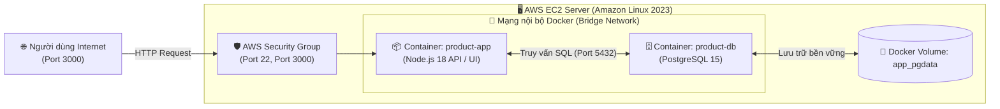
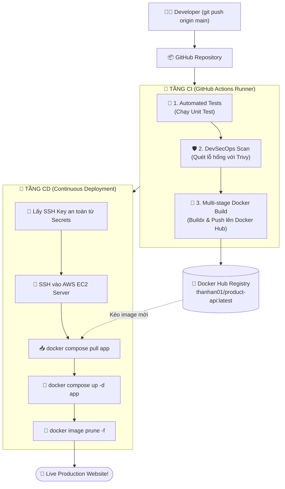

# 🚀 Automated DevOps CI/CD Pipeline & Product REST API

[](https://github.com/TAn031104/product/actions/workflows/deploy.yml)


> **Dự án DevOps thực chiến:** Đóng gói ứng dụng Web 2-tier (Node.js REST API + PostgreSQL Database), tích hợp quy trình **CI/CD tự động hóa 100%** bằng **GitHub Actions**, quét mã độc an ninh mạng bằng **Trivy**, quản lý kho ảnh bằng **Docker Hub**, và tự động triển khai (Continuous Deployment) lên máy chủ đám mây **AWS EC2**.

---

## 🏛️ 1. Sơ đồ Kiến trúc Hệ thống (System Architecture)

Hệ thống được vận hành theo mô hình đa tầng (Multi-tier Containerized Architecture) trên máy chủ AWS EC2:



---

## 🔄 2. Sơ đồ Luồng hoạt động CI/CD (Pipeline Workflow)

Mỗi khi có code mới được merge hoặc push vào nhánh `main`, toàn bộ quy trình sau sẽ tự động thực thi khép kín:



---

## 🌟 3. Điểm sáng Kỹ thuật & DevOps Best Practices

* **Tự động hóa toàn diện (Zero-Touch Deployment):** Loại bỏ hoàn toàn thao tác thủ công trên máy chủ. Mọi bước từ kiểm thử, đóng gói đến cập nhật ứng dụng đều do GitHub Actions điều phối.
* **Tích hợp DevSecOps sớm (Shift-Left Security):** Tự động quét các gói phụ thuộc để phát hiện và ngăn chặn các lỗ hổng bảo mật nghiêm trọng (CVE) bằng công cụ **Aqua Security Trivy**.
* **Tối ưu hóa Container (Multi-stage Build):** `Dockerfile` tách biệt môi trường build và production runtime, giúp giảm thiểu tối đa kích thước Docker image, tăng tốc độ triển khai và hạn chế bề mặt tấn công.
* **Bảo mật Bí mật (Secrets Management):** Sử dụng **GitHub Secrets** để bảo vệ tuyệt đối Private SSH Key và Docker Hub Token. Tuyệt đối không để lộ thông tin nhạy cảm trong mã nguồn Git.
* **Bảo toàn Dữ liệu (Data Persistence):** Database PostgreSQL sử dụng **Docker Named Volumes (`pgdata`)** độc lập với vòng đời container. Khi cập nhật ứng dụng (Deploy mới), dữ liệu kinh doanh vẫn được bảo toàn nguyên vẹn 100%.

---

## 📡 4. Danh sách API Endpoints

Ứng dụng cung cấp đầy đủ các endpoint REST API CRUD phục vụ quản lý sản phẩm:

| Phương thức | Đường dẫn | Chức năng | Trạng thái phản hồi |
| :---: | :--- | :--- | :---: |
| `GET` | `/` | Giao diện Dashboard quản lý sản phẩm | `200 OK` |
| `GET` | `/health` | Kiểm tra tình trạng sức khỏe hệ thống (Health Check) | `200 OK` |
| `GET` | `/api/products` | Lấy toàn bộ danh sách sản phẩm | `200 OK` |
| `GET` | `/api/products/:id` | Xem chi tiết 1 sản phẩm theo ID | `200 OK` / `404` |
| `POST` | `/api/products` | Thêm sản phẩm mới | `201 Created` |
| `PUT` | `/api/products/:id` | Cập nhật thông tin sản phẩm | `200 OK` |
| `DELETE` | `/api/products/:id` | Xóa sản phẩm khỏi hệ thống | `200 OK` |

---

## 🛠️ 5. Công nghệ Sử dụng (Tech Stack)

* **Ngôn ngữ & Runtime:** Node.js 18, Express.js
* **Cơ sở dữ liệu:** PostgreSQL 15 Alpine
* **Đóng gói & Điều phối:** Docker, Docker Compose, Multi-stage Build
* **CI/CD Platform:** GitHub Actions
* **An ninh mạng (DevSecOps):** Aqua Security Trivy
* **Hạ tầng đám mây (Cloud Infrastructure):** AWS EC2 (Amazon Linux 2023), AWS Security Group
* **Kho lưu trữ Container (Registry):** Docker Hub (`thanhan01/product-api`)

---

## 💻 6. Hướng dẫn Chạy ứng dụng ở Môi trường Local

### Cách 1: Sử dụng Docker Compose (Khuyên dùng)
```bash
# Khởi chạy toàn bộ hệ thống (App + PostgreSQL) trong 1 lệnh
docker compose up -d --build

# Xem logs hoạt động
docker compose logs -f

# Tắt hệ thống
docker compose down
```
Ứng dụng sẽ khả dụng ngay tại: `http://localhost:3000`

### Cách 2: Chạy trực tiếp (Không dùng Docker)
```bash
# 1. Cài đặt thư viện
npm install

# 2. Khởi chạy bài kiểm thử tự động
npm test

# 3. Khởi chạy ứng dụng
npm start
```

---

## 📂 7. Cấu trúc Thư mục Dự án

```
product/
├── .github/
│   └── workflows/
│       └── deploy.yml          # Kịch bản CI/CD GitHub Actions hoàn chỉnh
├── public/
│   └── index.html              # Giao diện Dashboard UI người dùng
├── src/
│   ├── config/
│   │   ├── db.js               # Kết nối Database PostgreSQL & Fallback mode
│   │   └── initDB.js           # Khởi tạo bảng dữ liệu tự động
│   ├── controllers/
│   │   └── productController.js# Xử lý logic nghiệp vụ CRUD
│   ├── routes/
│   │   └── productRoutes.js    # Định tuyến API
│   └── index.js                # Điểm khởi chạy ứng dụng (Express Server)
├── tests/
│   └── health.test.js          # Bộ Unit Tests tự động
├── docker-compose.yml          # Cấu hình điều phối container (App + DB)
├── Dockerfile                  # Đóng gói Multi-stage Docker image
├── package.json
└── README.md
```

---

## 📜 Giấy phép (License)
Dự án được phát hành theo giấy phép **MIT License**.
